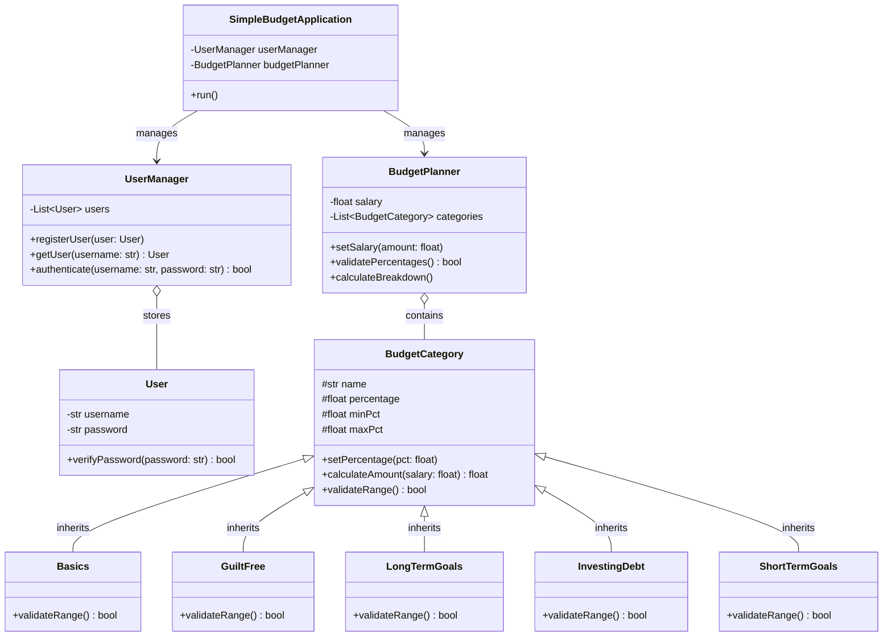

# CS3SY26_ProjectProposal by Be_21 Santos, Be_23 Sudeep, and Be_26 Tayao

### Project Title or Name of the Application	: BudgeDING SimpleBudget: Financial Planner
### Section			   	      : 9 - Beryllium
### Group Members			    : SANTOS, Marquiz, SUDEEP, Shiloh, TAYAO, Josemaria
### Date (Proposal Date)  : Nov 13, 2026

## Project Description
**BudgeDING SimpleBudget: Financial Planner** is a simple Python app that helps people manage their money without the headache. There are lots of students and young earners that have a hard time budgeting because standard spreadsheets and finance apps can be either too confusing or too strict. SimpleBudget fixes this by walking users through an easy, percentage-based budgeting setup.

So that you can use the app, you first need to create an account, log in, then enter your allowance or salary. From there, you can split your money across five everyday categories: **Basics**, **Guilt-Free Spending**, **Long-Term Goals**, **Investing/Debt**, and **Short-Term Goals**. You can customize how much goes into each category, while the app makes sure your numbers stay realistic (like keeping **Basics** between 50% and 60%) and add up to 100%. Once your percentages are set, SimpleBudget automatically calculates and shows you the exact amount of money you should put toward each category.

---

## Target Users
* **Primary Users:** High school and college students that need to manage allowances, part-time workers, and beginner earners that want an easy-to-use personal finance tool.
* **User Needs:** These users need a simple, structured way to divide their limited income between daily necessities, savings, and personal spending without needing much accounting knowledge or complicated financial software.

---

## System Features & OOP Design

### Core Features & Expected Outputs
* **User Registration & Authentication:** Allows new users to register an account and existing users to log in securely before accessing budget tools.
* **Customizable Percentage Allocation:** Prompts users to enter their salary and adjust default category percentages within validated minimum and maximum limits while enforcing a total sum of `1.0`.
* **Automated Monetary Breakdown:** Calculates and outputs the exact currency amount allocated to each of the five budget categories based on the user's income.

### Object-Oriented Programming (OOP) Architecture

#### 1. `SimpleBudgetApplication` *(Main Controller Class)*
* **Attributes:**
  * `userManager` *(UserManager)*: Handles account registration and login validation.
  * `budgetPlanner` *(BudgetPlanner)*: Manages salary input, percentage validation, and budget calculations.
* **Methods:**
  * `run()`: Controls the main application loop, user menus, and program flow.

#### 2. `UserManager` & `User` *(Authentication Classes)*
* **`User` Attributes & Methods:** Stores `username` *(str)* and `password` *(str)*, with `verifyPassword(password)` to check login credentials.
* **`UserManager` Attributes & Methods:** Stores a list of registered accounts (`users: List<User>`) and provides `registerUser(user)`, `getUser(username)`, and `authenticate(username, password)` to manage user access.

#### 3. `BudgetPlanner` *(Budget Engine Class)*
* **Attributes:**
  * `salary` *(float)*: Stores the user's primary income.
  * `categories` *(List<BudgetCategory>)*: Holds instances of the five budget category subclasses.
* **Methods:**
  * `setSalary(amount)`: Records and validates the user's income input.
  * `validatePercentages()`: Checks that all category percentages fall within allowed bounds and sum to `1.0`.
  * `calculateBreakdown()`: Iterates through `categories` to compute and display the final monetary values.

#### 4. `BudgetCategory` *(Parent Class)* & Subclasses
* **Parent Class (`BudgetCategory`):** Defines shared protected attributes (`name`, `percentage`, `minPct`, `maxPct`) and methods (`setPercentage(pct)`, `calculateAmount(salary)`, and `validateRange()`).
* **Child Classes (`Basics`, `GuiltFree`, `LongTermGoals`, `InvestingDebt`, `ShortTermGoals`):** Each subclass inherits from `BudgetCategory` and overrides `validateRange()` to enforce its own realistic percentage limits (e.g., `0.50–0.60` for `Basics`), demonstrating **inheritance** and **polymorphism**.

### Class Interactions
When `SimpleBudgetApplication.run()` starts, it will interact with `UserManager` so that it can register or authenticate a `User` object. When the user has logged in, `SimpleBudgetApplication` passes control to `BudgetPlanner`, which stores the user's `salary` and manages a list of the five `BudgetCategory` child objects. When the user will customize their percentages, `BudgetPlanner` calls `validateRange()` on each subclass individually and polymorphically, before running `calculateAmount(salary)` to display the final financial breakdown.

## Class Diagram ##

### Goals:

### Long-Term Goal
To encourage students, young people, and beginner earners to develop and practice consistently healthy financial habits by giving them an accessible, easy-to-use personal budgeting tool that removes the confusion and complexity of traditional financial planning.

### Specific Objectives
* **Objective 1:** Have and manage safe user registration, login authentication, and income storage, by making a clear Object-Oriented Programming (OOP) class structure that includes UserManager, User, BudgetPlanner, and the BudgetCategory hierarchy.
* **Objective 2:** Make a user-friendly console application (or a simple GUI) that asks users for their salary and allows them to customize allocation percentages of the five categories (`Basics`, `GuiltFree`, `LongTermGoals`, `InvestingDebt`, and `ShortTermGoals`).
* **Objective 3:** Implement validation logic that uses realistic category bounds (such as keeping `Basics` within `0.50–0.60`) and ensures all percentages sum to `1.0`, then accurately calculates and displays the resulting monetary breakdown for each category.
