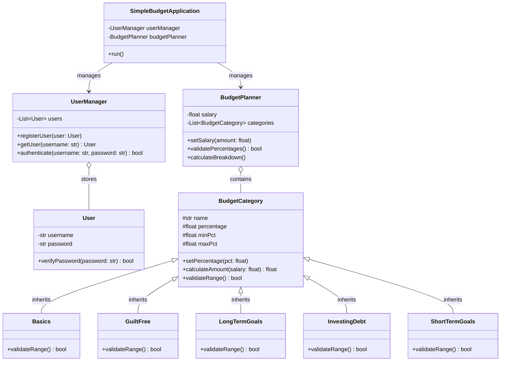

# CS3SY26_ProjectProposal by Aline Teresa Mendoza from CS Unit of PSHS

### Project Title or Name of the Application	: BudgeDING
### Section			   	      : 9 - Beryllium
### Group Members			    : SANTOS, Marquiz, SUDEEP, Shiloh, TAYAO, Josemaria
### Date (Proposal Date)  : Nov 5, 2026

## Project Description
**SimpleBudget: Personalized Financial Planner (V1.0)** is a streamlined Python-based personal finance application designed to give users direct, stress-free control over their core budget[cite: 10]. Many students, young adults, and first-time earners struggle to manage their money because traditional spreadsheets and budgeting tools are either overly complicated or too rigid for changing expenses. SimpleBudget solves this problem by providing an intuitive, guided system that divides a user's income into clear, percentage-based financial categories[cite: 10].

The application implements a secure user registration and login flow, prompts users to input their primary salary or income, and allows them to customize allocation percentages across five core categories: **Basics**, **Guilt-Free Spending**, **Long-Term Goals**, **Investing/Debt**, and **Short-Term Goals**[cite: 10, 11]. To keep budgets realistic and balanced, the system validates each category within practical ranges (for example, keeping **Basics** between `0.50` and `0.60`) and ensures that all category percentages sum up to exactly `1.0` (100%)[cite: 10]. Once validated, the program automatically calculates and displays the exact monetary breakdown for each category, enabling clear financial planning without unnecessary complexity[cite: 10].

---

## Target Users
* **Primary Users:** High school and college students managing allowances, part-time workers, and beginner earners looking for an easy-to-use personal finance tool[cite: 10].
* **User Needs:** These users need a simple, structured way to divide their limited income between daily necessities, savings, and personal spending without needing prior accounting knowledge or complicated financial software[cite: 3, 10].

---

## System Features & OOP Design

### Core Features & Expected Outputs
* **User Registration & Authentication:** Allows new users to register an account and existing users to log in securely before accessing budget tools[cite: 10, 11].
* **Customizable Percentage Allocation:** Prompts users to enter their salary and adjust default category percentages within validated minimum and maximum limits while enforcing a total sum of `1.0`[cite: 10, 11].
* **Automated Monetary Breakdown:** Calculates and outputs the exact currency amount allocated to each of the five budget categories based on the user's income[cite: 10, 11].

### Object-Oriented Programming (OOP) Architecture

#### 1. `SimpleBudgetApplication` *(Main Controller Class)*
* **Attributes:**
  * `userManager` *(UserManager)*: Handles account registration and login validation[cite: 11].
  * `budgetPlanner` *(BudgetPlanner)*: Manages salary input, percentage validation, and budget calculations[cite: 11].
* **Methods:**
  * `run()`: Controls the main application loop, user menus, and program flow[cite: 11].

#### 2. `UserManager` & `User` *(Authentication Classes)*
* **`User` Attributes & Methods:** Stores `username` *(str)* and `password` *(str)*, with `verifyPassword(password)` to check login credentials[cite: 11].
* **`UserManager` Attributes & Methods:** Stores a list of registered accounts (`users: List<User>`) and provides `registerUser(user)`, `getUser(username)`, and `authenticate(username, password)` to manage user access[cite: 11].

#### 3. `BudgetPlanner` *(Budget Engine Class)*
* **Attributes:**
  * `salary` *(float)*: Stores the user's primary income[cite: 10, 11].
  * `categories` *(List<BudgetCategory>)*: Holds instances of the five budget category subclasses[cite: 11].
* **Methods:**
  * `setSalary(amount)`: Records and validates the user's income input[cite: 10, 11].
  * `validatePercentages()`: Checks that all category percentages fall within allowed bounds and sum to `1.0`[cite: 10, 11].
  * `calculateBreakdown()`: Iterates through `categories` to compute and display the final monetary values[cite: 10, 11].

#### 4. `BudgetCategory` *(Parent Class)* & Subclasses
* **Parent Class (`BudgetCategory`):** Defines shared protected attributes (`name`, `percentage`, `minPct`, `maxPct`) and methods (`setPercentage(pct)`, `calculateAmount(salary)`, and `validateRange()`)[cite: 11].
* **Child Classes (`Basics`, `GuiltFree`, `LongTermGoals`, `InvestingDebt`, `ShortTermGoals`):** Each subclass inherits from `BudgetCategory` and overrides `validateRange()` to enforce its own realistic percentage limits (e.g., `0.50–0.60` for `Basics`), demonstrating **inheritance** and **polymorphism**[cite: 10, 11].

### Class Interactions
When `SimpleBudgetApplication.run()` starts, it interacts with `UserManager` to register or authenticate a `User` object[cite: 11]. Once logged in, `SimpleBudgetApplication` passes control to `BudgetPlanner`, which stores the user's `salary` and manages a list of the five `BudgetCategory` child objects[cite: 11]. When the user customizes their percentages, `BudgetPlanner` calls `validateRange()` on each subclass polymorphically before running `calculateAmount(salary)` to display the final financial breakdown[cite: 10, 11].

### Goals:

To develop a functional, educational Python simulation that demonstrates how Object-Oriented Programming models real-world smart home automation while promoting awareness of household energy efficiency[cite: 7].

- Objective 1: Design and implement an inheritance hierarchy with one parent class (SmartDevice) and at least three specialized child classes (SmartLight, SmartThermostat, SmartLock) by the end of the 3rd Quarter[cite: 7].
- Objective 2: Build an interactive command-line menu (or tkinter GUI) in SmartHomeHub that lets users add devices, trigger sensor events, and view real-time automation logs[cite: 7].
- Objective n: Implement an accurate energy consumption calculator that reports total kilowatt-hours (kWh) used across simulated time intervals and test the system across at least 5 household scenarios before the 4th Quarter deadline[cite: 7].

[Click here for Rubrics and Sample projects](https://docs.google.com/document/d/1xKd1CqK6DcNWS2_oJPBNtY5n3I3Hqiw8FY3W295Iqfk/edit?usp=sharing)
